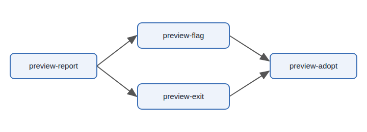

# Design: preview a copy before it writes (sample, new layout)

## What

Add a way to see what `onetaskgraph copy` would write before it writes anything, so a person can check a plan's copy to a board without touching the board.

## Why

A copy that lands wrong on a shared board is noticed by everyone and undone by hand. Seeing the outcome first makes the copy safe to try.

## Architecture

### Copy planner — `nickderobertis/onetaskgraph`

The planner already reads both ends before it writes. A preview stops after the plan and prints it.

#### The preview report is the copy report

**Reversibility: high cost** — other tools parse the report, so its shape cannot change once released.

A preview prints exactly the report a real copy prints, with every write marked as not made. Nothing else is added to the report, so a tool that reads a copy's report reads a preview's without change.

<details>
<summary>Examples</summary>

The prose example: copying a project with two tasks into a board that holds one of them reports one task as `would-create` and one as `would-update`, and the board is left as it was.

```json
{"items": [
  {"source": "notes:T1", "outcome": "would-create"},
  {"source": "notes:T2", "outcome": "would-update", "destination": "board:I_42"}
]}
```

</details>

**Reversible:**

<details>
<summary>Adds a <code>--dry-run</code> flag to <code>copy</code></summary>

The flag is `--dry-run`, the name every other verb of the command line already uses for a run that writes nothing.

</details>

<details>
<summary>Prints items in the order the copy would write them</summary>

Items are printed in the order the copy would write them, so the preview reads as a script of the copy.

</details>

<details>
<summary>Exits <code>4</code> when any item would be refused</summary>

A preview exits `0` when the copy would succeed and `4` when any item would be refused, the same codes the copy itself uses.

</details>

## Planned tasks



<details>
<summary>Task table</summary>

| Task | Unit | What it delivers | Depends on | Where it lives |
| --- | --- | --- | --- | --- |
| `preview-report` | Copy planner | The report a preview prints | none | `nickderobertis/onetaskgraph` |
| `preview-flag` | Copy planner | The `--dry-run` flag on `copy` | `preview-report` | `nickderobertis/onetaskgraph` |
| `preview-exit` | Copy planner | The preview's exit codes | `preview-report` | `nickderobertis/onetaskgraph` |
| `preview-adopt` | Orchestrator | The planning flow previews every copy | `preview-flag`, `preview-exit` | `nickderobertis/ai-orchestrator` |

</details>
